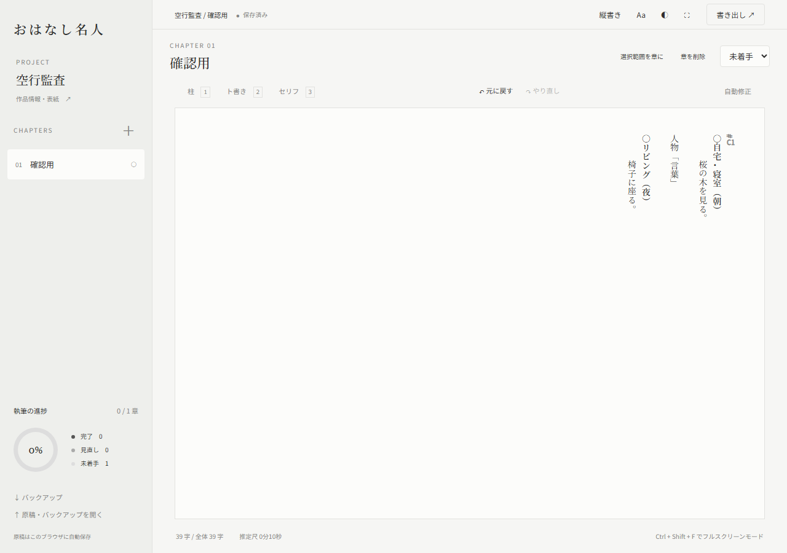

# おはなし名人 要望反映監査

2026年10月24日 00:32 JST時点。対象は [pikoponpoko/ohanashi-meijin](https://github.com/pikoponpoko/ohanashi-meijin) のmainと [正式公開サイト](https://ohanashi-meijin.pikoponpoko.workers.dev/)。コード変更・GitHubへの書込み・本番再デプロイは行っていない。

## 結論

**要望がすべて実装・公開まで完了したとは判定できない。公開漏れよりも、仕様の引継ぎとテスト条件に不足がある。**

- PWAは未実装。manifestの参照、アプリアイコン、service workerの登録がない。
- 空行整理は一部実装。「連続空行を1行へ圧縮」であり、単独の空行や先頭・末尾の空段落を残す。公開サイトで再現した。
- 新規の保存領域ではサンプルを開かない。旧版サンプルが保存済みなら、その原稿を復元して「余白の向こう」が開く。これも公開サイトで再現した。
- サイドバー外側タップ、二本指Undo／三本指Redoはコードとブラウザテストに存在する。Android実機での成立は未確認。
- GitHubの全配信ファイル11件は公開版と一致。監査対象コミットは [e0359687ff29f16a86be8746d49f3d6b9b14af18](https://github.com/pikoponpoko/ohanashi-meijin/commit/e0359687ff29f16a86be8746d49f3d6b9b14af18)。Windowsチェックアウトの改行差を除き、Gitに保存されたバイト列と直接照合した。

## 依頼から公開まで追えた範囲

| 段階 | 確認した事実 |
|---|---|
| 「エディタ修正1023」 | 10月23日18:03 JSTのユーザー原文に、空白で開始、スマホのエディター側タップでサイドバーを閉じる、二本指Undo／三本指Redoがある。同チャットに、選択範囲の章移動で書式崩れ、章削除時のバックアップ任意化、DropboxのJSONが選択できないという依頼もある。 |
| 「Cloudflare Worker公開方法」 | 「Visitでも表示できる。でもスマホにアプリとしてインストールできない」というユーザー原文がある。 |
| 回収したHANDOFF.md | 空白起動、外側タップ、指ジェスチャー、空行整理、ID保持、章移動、任意バックアップ削除、JSON、PDFを記載。PWAの記載は見つからない。元資料名として「おはなし名人_Codex修正指示書_2026-10-23_全9項目.md」を参照するが、本文は含まない。 |
| 「おはなし＠クラウド」の実装記録 | IMPLEMENTATION.mdの作成ログに「元の『全9項目』指示書そのものは今回の添付に含まれていないため、HANDOFF.mdとソースを基に対応」と明記されている。 |
| GitHubへの統合 | 10月23日23:32 JST、e035968で実装とテストをmainに統合。HANDOFF.md／IMPLEMENTATION.md自体は現行リポジトリに含まれない。 |
| 「おはなし＠クラウド2」 | 10月23日23:56 JSTの報告で既存Workerへのデプロイ、バージョン22cc14aa-531b-4f8d-965e-afdfbd0c4932、本番100%、54テスト成功を記録。バージョンIDと配信比率は当時のログによる。今回Cloudflare管理APIでの再照会はしていない。 |
| 今回の監査 | 公開サイトの11ファイルがmainのGitオブジェクトと一致。既存54ブラウザチェックを正式URLに対して再実行し全件合格。追加監査で不足を再現。 |

参照チャット：[エディタ修正1023](chatgpt-conversation://6adb0f62-9804-83ee-903d-6bbce1a5e97b)、[Cloudflare Worker公開方法](chatgpt-conversation://6adb2f29-5d08-83ec-89d6-0d4ffcb86503)。履歴から回収した資料は [HANDOFF原文](evidence/回収したHANDOFF.md) に保存した。

**「全9項目」の元指示書本文は回収できていない。以下は確認できた要望・引継ぎ内容の機能別判定であり、元指示書の9項目と番号を一致させた完了表ではない。** ChatGPT回答の一部も本文ではなく参照記号だけが返るため、欠けた指示を推測で補っていない。

## 実装・公開の判定

「実装」はコードがあり、ここに記した試験範囲で動作したもの。「一部実装」は要望の一部を満たすが残件があるもの。「要再現」は実機・実データの確認が残るものとする。

| 要望・機能 | 判定 | コード・テスト・残件 |
|---|---|---|
| Android ChromeでPWAインストール | **未実装** | HTMLにmanifest参照・icon参照なし。公開ページのSW登録0件。manifest.webmanifest、manifest.json、sw.js、service-worker.js、一般的な192／512アイコン候補パスは404。HTTPSのみ成立。Androidの実メニュー操作は未確認。 |
| 初回起動を空白に | **実装** | 保存データなしでは作品名空、1章、本文は内部カット「#C1」と空段落。サンプル本文なし。既存テストと追加検証で確認。完全に何も表示しない状態ではなく、#C1が見え文字数も3字と表示される。 |
| 旧サンプルが再び開く問題 | **一部実装・再現済み** | 旧mainの実際の初期データを保存領域に配置すると「余白の向こう」と3章が復元される。既存原稿の保護動作でもあるため、無条件削除は不可。新しい作品を作る操作やサンプル移行の案内はない。ユーザー端末の実データ・キャッシュは調べていないので、その端末の原因を断定はしない。 |
| 空行・空段落の除去 | **一部実装・不足再現済み** | repairは空白判定にtrimを使い、各連続空白群の最初の1行を残す。単独空行は削除対象にならず、整理ボタンも出ない。全角空白・タブ・NBSPの行は空文字になるが、空段落は残る。詳細は次節。 |
| スマホの外側タップで閉じる | **実装／実機は要再現** | 390×844のタッチ対応ブラウザで、背景タップによる閉鎖と原稿不変を確認。CSSは幅680px以下のみ。844×390では常設サイドバーになり、メニューボタンと背景オーバーレイは非表示。横向きスマホも同じ操作を求めるなら追加対応が必要。 |
| 二本指Undo・三本指Redo | **実装／実機は要再現** | エディター内のTouchEventを処理。300ms未満、指の追加120ms以内、移動10px以内等の制限あり。合成イベントでUndo／Redo・移動時の抑止が合格。OSジェスチャー、ピンチ、選択、キーボード、Android／iPhone実機の競合は未検証。画面全域のジェスチャーではない。 |
| 選択範囲を章へ移す際の書式保持 | **実装** | 論理DOMとformatsを使う。全段落・段落途中の選択、柱／ト書き／セリフ、保存復元、Undo／Redo、カットID維持のテストが合格。実際に問題が出た原稿・操作録画と同一条件では未再現。 |
| 章削除のバックアップ任意化 | **実装** | チェックなし削除、任意バックアップ、キャンセル、Undoを検証。JSON復元前のバックアップは引き続き必須だが、章削除とは別の操作。 |
| スマホでDropboxのJSONを選択 | **実装／実機は要再現** | file inputのaccept制限を撤去。大文字.JSON、application/octet-streamで読込・復元が合格。不正JSON拒否も合格。AndroidのDropbox実プロバイダーは未検証。 |
| 貼り付けで改行が増殖しない | **実装** | innerText依存をやめ論理DOMを読み取る。10回の描画・取得、5章への同内容貼付け、複数段落選択置換、カーソル位置、独自クリップボード不正時のフォールバックを検証。既存の空行を全削除する実装ではない。 |
| カット連番・永続ID | **実装** | 全章連番、旧番号重複の移行、途中挿入、copy時新ID、cut移動時ID保持、再貼付け重複防止、保存復元を検証。 |
| 作品全体のUndo／Redo・IME保護 | **実装／IME実機は要再現** | 本文、章、設定等を最大150状態で保持。再読込まで。キーボード・ボタン・合成タッチ、IME中のEnter抑止が合格。日本語IMEの実入力による網羅検証ではない。 |
| PDF直接保存・通常印刷の分離 | **実装／品質制限あり** | PDF直接DL、表紙有無、A4横、長文・複数章の文字列・段落種別の保持を検証。PDFは画像形式で検索・文字選択不可。既存54テストはGoogle Fonts通信を止めており、3書体のテスト名があっても実Webフォントの品質検証を意味しない。 |
| 保存失敗・破損データ保護 | **実装** | 保存前構造検証、容量不足、破損JSON、自動保存停止、元の生データ退避、退避失敗時の復元中止を検証。 |
| プリプロ名人との構造化連携 | **未実装** | JSONにはカットIDあり。TXT／MDは内部IDを含まない。相手側ID受入・差分同期・番号だけで既存Vコンへ対応付ける機能はない。過去の提案は後に「現段階では実装せず調査のみ」と指定されており、今回の無断追加対象にはしない。 |
| 画面名・基本UI整理 | **実装** | 「おはなし名人」、自動修正、文字設定、14px既定、行間圧縮、ダークサイドバー／スクロールバー、縦書きホイール、PDF／印刷分離等のコードを確認。旧い表示設定を保存している場合は既定値より保存値が優先される。 |

主なコード根拠： [初期化・保存復元](https://github.com/pikoponpoko/ohanashi-meijin/blob/e0359687ff29f16a86be8746d49f3d6b9b14af18/dist/app.js#L3)、[空行修復](https://github.com/pikoponpoko/ohanashi-meijin/blob/e0359687ff29f16a86be8746d49f3d6b9b14af18/dist/model.js#L25)、[修復UI・モバイル操作](https://github.com/pikoponpoko/ohanashi-meijin/blob/e0359687ff29f16a86be8746d49f3d6b9b14af18/dist/editing.js#L52)、[章削除・移動](https://github.com/pikoponpoko/ohanashi-meijin/blob/e0359687ff29f16a86be8746d49f3d6b9b14af18/dist/app.js#L79)、[ブラウザテスト](https://github.com/pikoponpoko/ohanashi-meijin/blob/e0359687ff29f16a86be8746d49f3d6b9b14af18/tests/browser.py)。

## 空行が残る理由

公開版の自動修正→「増殖した空行を整理」で、次を確認した。

| 入力 | 整理後 | 再度整理できるか |
|---|---|---|
| 本文の間に空行1行 | 1行残る | ボタンが出ない |
| 本文の間に連続空行3行 | 1行残る | ボタンが出ない |
| 先頭・末尾の連続空行 | 先頭・末尾に各1行残る | ボタンが出ない |
| 全角空白・タブ・NBSPだけの行 | 空文字の行になる | 残った空段落は消せない |
| U+200Bだけの行 | そのまま残る | ボタンが出ない |
| カット直前・直後の単独空行 | それぞれ残る | ボタンが出ない |

DOMの`  `と空の`
 
`から取り込んだケースでも、保存データに空行が残り、再描画後は独立した空段落として表示された。空段落の幅は14px設定で約23.09px。CSSのmin-widthとline-heightにより、縦書きでは空列として見える。

これは残余空白を生む経路の再現であり、添付画像のすべての余白がこの原因だという断定ではない。画像だけでは、実際の空行、通常の行間、字下げ、カット境界を判別できない。ユーザーの原稿そのものは取得・変更していない。

既存の空行テストは`\n\n\n`がなくなることを確認するだけで、`\n\n`を許している。したがって**54項目成功と、空行削除が不十分という実機報告は両立する**。

## PWAの判定上の注意

Chrome公式の[インストール促進条件](https://web.dev/articles/install-criteria)では、HTTPSに加え、name／short_name、192pxと512pxのicons、start_url、standalone等のdisplayを持つmanifestなどが必要。現行版はmanifest自体を参照していないため、この条件を満たしていない。

service worker不在は別途確認した事実であり、それ単独を現在のChromeでの全インストール方式の必須条件とは扱わない。Chromeには通常サイトを手動インストールできる場合もある。今回のデスクトップChromiumの`Page.getInstallabilityErrors`は空配列を返したが、manifest URL／dataは空でdisplayも未定義だった。空のエラー配列を「Androidでインストール可能」の証明には採用しない。

## 今回実行した検証と限界

- Node構文検査4ファイル、既存7チェック、モデルチェック：合格。
- 公開URLの既存ブラウザ回帰テスト：**54／54合格**。Windows、専用のChrome for Testing 156、独立した保存領域。テスト用データだけを使用した。
- 公開ファイル照合：**11／11一致**。Gitのオブジェクトを基準にSHA-256とバイト列を比較。
- 追加監査：新規起動、旧サンプル移行、8種の空白入力、BRを含むDOM、PWA状態、390px縦画面／844px横画面。
- Android実機、インストールメニュー、Dropbox実プロバイダー、実IME、OSとのジェスチャー競合は未検証。
- 元「全9項目」本文と、その後の修正版指示書全文は未回収。全項目への逐語照合は未完了であり、完了と偽っていない。

証拠：[配信照合](evidence/配信ファイル照合.json)、[PWAパス](evidence/PWA候補パス.json)、[54チェックログ](evidence/ブラウザ回帰テスト.txt)、[追加監査データ](evidence/追加監査結果.json)、[初期表示](evidence/初期表示.png)、[旧サンプル保存時](evidence/旧サンプル保存時.png)、[スマホ縦](evidence/スマホ縦画面.png)、[スマホ横](evidence/スマホ横画面.png)。

## 修正の優先順

1. PWAのmanifest・アイコン・SWと更新／オフライン動作を実装し、Android実機で確認する。
2. 明示的な空行削除を用意し、モデル文字列とDOMの両方で残余空行ゼロを検証する。カットID・本文・書式・Undoを守る。
3. 既存原稿を消さずに新しい空白作品を始められる操作を用意する。旧サンプルをユーザー原稿と決めつけて削除しない。
4. スマホ横向きとOSジェスチャー競合を実機で再現する。
5. 元の全9項目指示書を回収し、要求・コード・テスト・公開確認を一対一で管理する。

具体的な作業条件は [修正指示書](audit-followup-plan.md) にまとめた。この監査では本番を変更していない。
